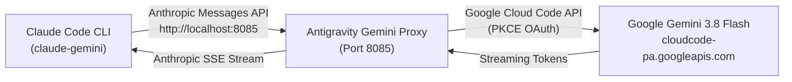

# 🛸 Claude Code + Gemini 3.8 Flash Bridge

[](LICENSE)
[](https://microsoft.com)
[](https://nodejs.org)
[](https://deepmind.google/technologies/gemini/)

> **Run Anthropic's Claude Code CLI powered by Google's latest Gemini 3.8 Flash models with zero Anthropic API bills, full multi-account load balancing, and an automated 1-click Windows installer.**

---

## ⚡ Highlights

- **⚡ Blazing Fast Gemini 3.8 Flash**: Execute Claude Code commands backed by Google DeepMind's fastest and most capable models (`gemini-3.8-flash-high`, `gemini-3.8-flash-low`, `gemini-2.5-pro`).
- **📦 1-Click Native Installer**: Packaged with a standalone Windows `Installer.exe` that sets up all environment variables, PATH, proxy services, and Claude configurations in seconds.
- **🛡️ Intelligent Port Routing**: Pre-configured on dedicated port `8085` to avoid common Windows port collisions (e.g., Steam CEF debugger on `8080`).
- **🔄 Multi-Account Load Balancing**: Link multiple Google accounts via PKCE OAuth with automatic rate-limit detection and seamless fallback switching.
- **🖥️ Desktop & CLI Integration**: Includes a desktop launcher `Launch Claude Code (Gemini).bat` and global terminal command `claude-gemini`.

---

## 🏗️ Architecture



---

## 🚀 Quick Start (1-Click Install)

### Option A: Standalone Windows Installer (Recommended)
1. Download **`Installer.exe`** and **`Installer.exe.sha256`** from the latest [GitHub Release](../../releases), verify the checksum (`Get-FileHash Installer.exe -Algorithm SHA256`), then double-click the installer.
2. The installer will:
   - Verify Node.js and Claude Code CLI.
   - Configure Claude Code's `settings.json` with Gemini model mappings.
   - Set up user environment variables and PATH.
   - Start the background proxy service on port `8085`.
   - Open your browser to link your Google account.
3. You're done! Launch Claude Code anytime via `claude-gemini` or the desktop shortcut.

---

### Option B: PowerShell Setup
Open PowerShell in this directory and run:
```powershell
npm run setup
```
*(or `powershell -ExecutionPolicy Bypass -File ./scripts/setup.ps1`)*

---

## 🔑 One-Time Setup: Linking Your Google Account

The proxy routes requests through Google Cloud Code using your Google Account:

1. Open the local dashboard in your browser:
   👉 **[http://localhost:8085/](http://localhost:8085/)**
2. Click **"Add Your First Account"** (or **"Add Account"**).
3. Click **"Connect Google Account"** and sign in with your Google account.
4. Once completed, the dashboard will confirm: `✓ Account added successfully`.

> [!TIP]
> You can add multiple Google accounts on the dashboard. The proxy uses hybrid token-bucket load balancing to automatically rotate accounts if any account hits quota limits.

---

## 💻 Usage

### 1. From Terminal
Run from any Command Prompt or PowerShell:
```powershell
claude-gemini
```
Pass any Claude Code CLI arguments as usual:
```powershell
claude-gemini -p "explain the architecture of this repo"
```

### 2. From Desktop
Double-click **`Launch Claude Code (Gemini).bat`** on your Desktop.

---

## ⚙️ Model Configuration

The bridge automatically translates Anthropic model requests to Gemini:

| Anthropic Target | Gemini Model ID | Context Window | Use Case |
|---|---|---|---|
| `Opus / Sonnet / Default` | `gemini-3.8-flash-high` | 200k - 1M tokens | Deep reasoning & coding |
| `Haiku` | `gemini-3.8-flash-low` | 200k tokens | Fast, lightweight tasks |
| `Claude Subagent` | `gemini-3.8-flash-high` | 200k tokens | Background parallel runs |
| `Pro Tier` | `gemini-2.5-pro` | 2M tokens | Extreme reasoning & large repos |

To change the default model, edit `~/.claude/settings.json`:
```json
{
  "model": "gemini-3.8-flash-high",
  "env": {
    "ANTHROPIC_BASE_URL": "http://localhost:8085",
    "ANTHROPIC_API_KEY": "dummy",
    "ANTHROPIC_MODEL": "gemini-3.8-flash-high"
  }
}
```

---

## 🛠️ Service Management

You can manage the proxy service manually using the bundled scripts in `scripts/`:

- **Start Proxy**: `scripts\start-proxy.cmd`
- **Stop Proxy**: `scripts\stop-proxy.cmd`
- **Account Linker**: `scripts\add-account.cmd`
- **Dashboard UI**: Navigate to `http://localhost:8085/`

---

## 📂 Project Structure

```
claude-code-gemini-bridge/
├── .github/
│   └── workflows/
│       └── ci.yml               # Automated CI & build workflow
├── bin/
│   ├── claude-gemini.cmd        # Fast CLI launcher
│   └── Launch-Claude-Gemini.bat # Desktop batch launcher
├── src/
│   └── proxy/                   # Node.js API proxy & Anthropic adapter
├── scripts/
│   ├── setup.ps1                # PowerShell installer
│   ├── start-proxy.cmd          # Background service starter
│   ├── stop-proxy.cmd           # Proxy shutdown script
│   └── add-account.cmd          # Account linking shortcut
├── installer/
│   └── Installer.cs             # C# source; Installer.exe is built by CI and published on GitHub Releases
├── package.json                 # Project manifest & scripts
├── settings.example.json        # Reference Claude Code settings
├── .gitignore                   # Git ignore rules
├── LICENSE                      # MIT License
└── README.md                    # Documentation
```

---

## ❓ Troubleshooting

### 1. `* API error · Retrying in 0s` or `* Flowing... (19s)`
- **Cause**: The proxy is running but has 0 linked Google accounts.
- **Fix**: Open [http://localhost:8085/](http://localhost:8085/) in your browser, click **Add Account** -> **Connect Google Account**, and sign in.

### 2. `Both ANTHROPIC_AUTH_TOKEN and ANTHROPIC_API_KEY set`
- **Cause**: Conflicting environment variables in Windows user registry.
- **Fix**: Run the release `Installer.exe` or `npm run setup`, which unsets `ANTHROPIC_AUTH_TOKEN` and keeps `ANTHROPIC_API_KEY=dummy`.

### 3. Port `8080` In Use
- The bridge runs by default on port `8085` to avoid collisions with Steam, web servers, or CEF debuggers. If you need a custom port, edit `%USERPROFILE%\.config\antigravity-proxy\config.json`.

---

## 📄 License

This project is licensed under the [MIT License](LICENSE).

---

## 🔒 Security Notes

- The proxy listens on **`127.0.0.1` only** by default. Set `HOST=0.0.0.0` only if you understand that anyone who can reach the port can use your linked Google accounts.
- Requests from non-local browser origins and non-local `Host` headers are rejected (CSRF / DNS-rebinding protection). Add trusted origins with `ALLOWED_ORIGINS=https://a.example,https://b.example`.
- Set `WEBUI_PASSWORD` and `API_KEY` environment variables to require credentials for the dashboard and `/v1` API. Passwords are stored hashed (scrypt); plain-text values in config are automatically migrated on startup.
- Account and config files are written with owner-only permissions (`0600`).
- Email addresses in log output are automatically redacted.
- Dashboard responses include CSP, X-Content-Type-Options, X-Frame-Options and Referrer-Policy headers.

### Google OAuth Credentials

> [!WARNING]
> This repository does **not** ship a Google OAuth client secret. To link Google accounts you must supply your own OAuth client (create one in the [Google Cloud Console](https://console.cloud.google.com/apis/credentials)) and set both environment variables before starting the proxy:
>
> ```powershell
> $env:OAUTH_CLIENT_ID = "your-client-id.apps.googleusercontent.com"
> $env:OAUTH_CLIENT_SECRET = "your-client-secret"
> ```
>
> Never commit these values.

- This project routes requests through Google's Cloud Code API using Google OAuth. Review Google's terms before use; access may be restricted at Google's discretion.

## 🧪 Development

```bash
cd src/proxy
npm install
npm test
```
